# HomeFit 2

**A thoughtful plan. A pace that is yours.**

An in-place upgrade of HomeFit: a private, offline home workout coach with a strict black, white, and grayscale interface. The existing app, exercise IDs, local storage key, workout history, backup format, and double-click launch remain supported.

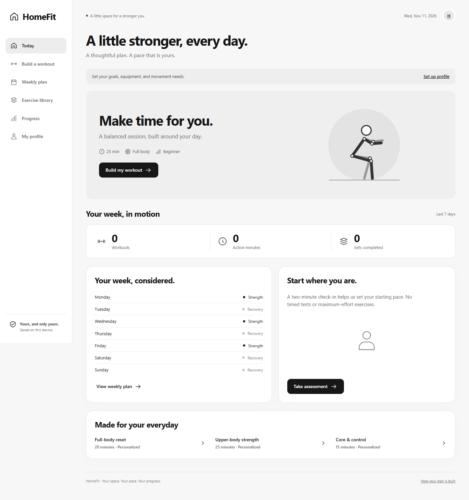

## Launch or continue using HomeFit

1. Keep using the existing `homefit` folder and the same browser.
2. Double-click **index.html**. No terminal, installation, Node.js, account, or server is needed.
3. Open **My profile** to check your equipment, band types, available resistance levels, and movement restrictions.
4. Choose **Take assessment** to set a comfortable starting pace.
5. Open **Weekly plan** for a spaced schedule, or **Build a workout** for a session now.

**Success indicator:** The grayscale dashboard appears. Your existing profile and history remain available, and any unfinished workout is restored paused.

If starting from the ZIP, extract the entire folder first, then double-click its `index.html`. To move an existing installation, export from **My profile → Export** before moving files, and import into the new location afterward. Browser storage for local files may depend on the folder path. Do not move the existing folder just to upgrade.

Chrome and Edge are the recommended local-file launch options. Mobile layouts work in browsers, but mobile operating systems vary in how they open local HTML folders. The same files can be served by a private static host for mobile access; nothing has been published by this delivery.

## What changed

| Improvement | Working behavior |
| --- | --- |
| Exercise replacement | Rechecks equipment, experience, restrictions, pain, muscle focus, and duplicates. Uses the replacement's own rep/hold prescription and resistance. Reduces sets if needed, without shortening prescribed rests. Rejects a replacement that cannot fit. |
| Duration limits | One timing calculation covers warm-up, work, rests between sets/exercises, transitions, and cooldown. There is no extra final rest. The active session stops at the selected time budget and preserves only actually logged sets. |
| Pain handling | Pain is attached only to explicitly affected movements. General or unidentified discomfort pauses new planning until reviewed. Resolving a report keeps the original history; another unresolved report still applies. |
| Fitness assessment | Three self-reported questions about recent activity, movement comfort, and recovery. No physical test or maximum-effort activity is required. A gentle baseline reduces complexity and volume; assessment never upgrades the selected experience level. |
| Exercise-level adaptation | Each set has a check-in; session review summarizes each movement separately. Two comfortable completed visits at comparable resistance can increase that movement's reps. Hard movements get less volume and more rest. |
| Resistance bands | 12 band movements within a 45-exercise library: 9 require long bands and 3 require mini loops. Select either or both types; generation, weekly plans, substitutions, and library alternatives match your selection. Light, medium, and heavy resistance controls remain available. |
| Bodyweight arms | Self-resisted biceps curls, narrow wall push-ups, and intermediate narrow knee push-ups include animated form guides. Workouts still honor experience, assessment, restrictions, pain feedback, and time limits. |
| Unavailable choices | A clear empty state offers compatible muscle focuses and profile editing. Old plans are cleared, and restrictions are never silently relaxed. Quick workouts use the same recovery flow. |
| Weekly plans | Two or three automatically spaced training days, configurable starting weekday, recovery days across week boundaries, appropriate muscle focus, and extra recovery after recent overlapping training. |
| Session continuity | Rep, load, band, and feedback entries survive pause and reload. Warm-up, rest, holds, early completion, cooldown, and export/import remain available. |
| Visual design | Neutral-only palette, black primary actions, white cards, clear typography, subtle motion, and compact mobile navigation. |

Original features are retained: weight in kg/lb, goals, time preferences, movement restrictions, personal notes, equipment inventory, generated workouts, substitutions, animated form diagrams, alternatives, search, filters, timed sessions, set tracking, progress statistics, full history, sample sessions, backups, and local saving.

## Take the assessment

1. Choose **Take assessment** on Today or My profile.
2. Answer the three questions from your recent everyday experience. You do not need to perform exercises now.
3. Select **Save assessment**.
4. Generate a new workout to use the updated baseline.

**Success indicator:** You see a result such as **A gentle start**, **Build your foundation**, or **Ready for consistency**. A gentle result produces beginner-level movements, one starting set per exercise, and extra recovery.

Assessment is a product heuristic, not a validated fitness score or medical clearance. Personal notes are reminders; only the actual profile controls and check-ins affect planning.

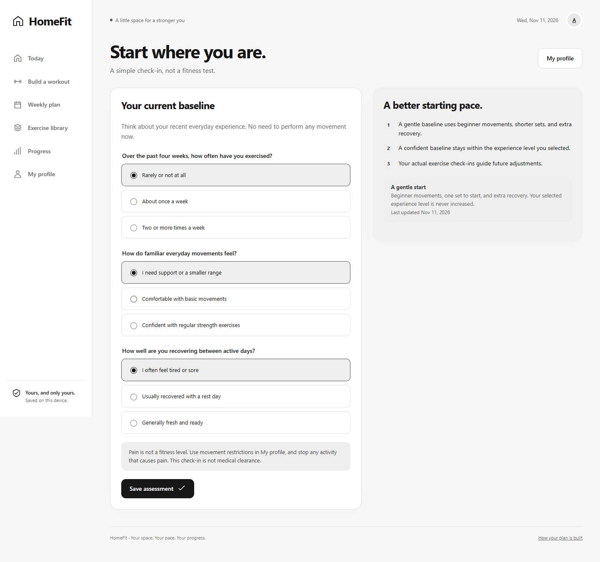

## Build and replace exercises

1. Choose a broad muscle focus or a specific muscle group, then an available time from 10 to 60 minutes.
2. Select **Generate workout** and review the prescribed sets, reps/hold seconds, rests, and resistance.
3. Use an exercise's swap button to see compatible alternatives.
4. Choose an alternative. The prescription and total estimate update together.
5. Open the exercise name to review its schematic animation, instructions, and alternatives.

**Success indicator:** The replacement is different, no duplicate is added, and the total estimated duration remains within the selected time budget.

For a bodyweight arm session, keep **Bodyweight** selected in My profile, choose **Arms** in the builder, and generate. Beginners without conflicting restrictions receive a self-resisted curl and narrow wall push-up. The knee variation is available at intermediate level. If restrictions or pain exclude all matching movements, choose one of the compatible focuses offered on screen. A focused workout may finish below your time limit; the app does not add excessive sets just to fill time.

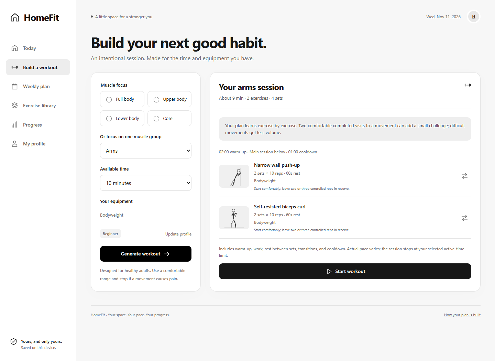

Work is estimated at four seconds per repetition. Timed holds use their prescribed seconds. Transitions are estimated at 20 seconds between exercises. Estimates are not a promise about an individual's pace; the active-time cap is a separate runtime control. If time expires, the review screen retains your completed sets and offers a reminder to cool down gently outside the recorded session. Paused time is excluded.

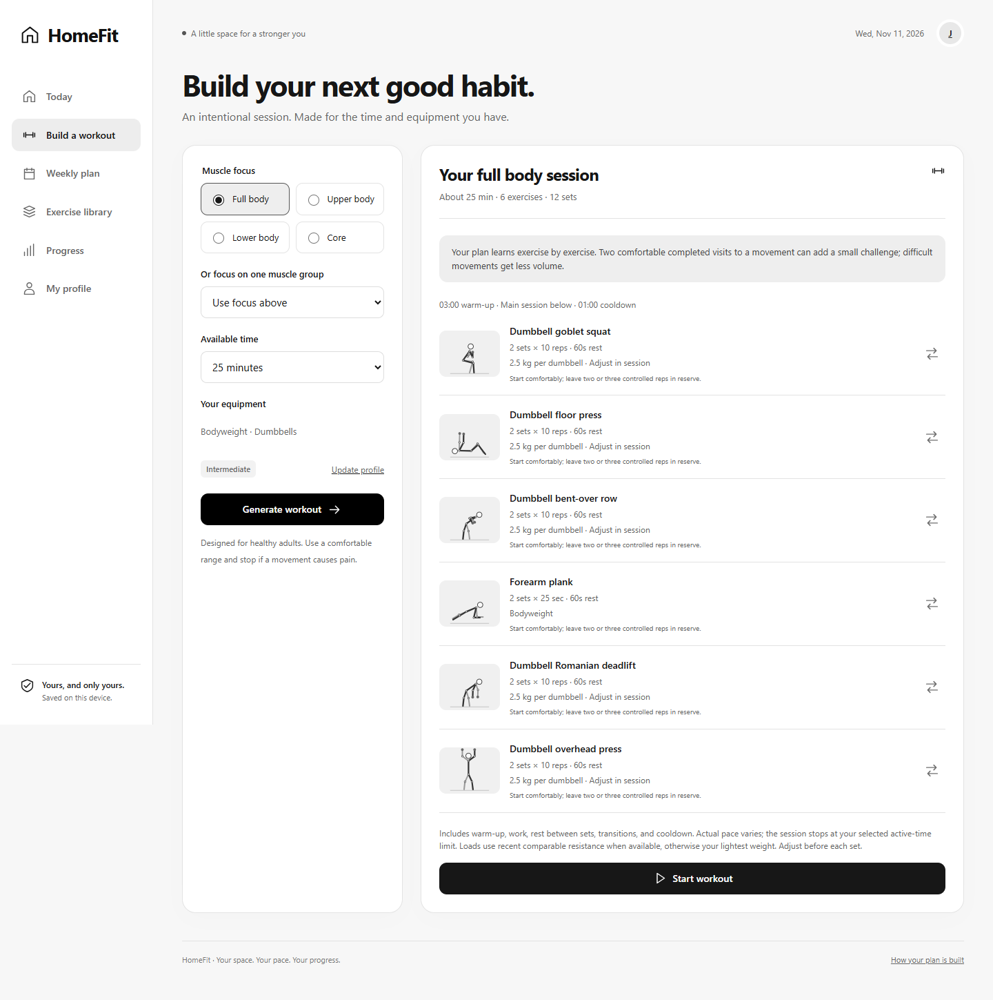

## Use resistance bands and movement check-ins

1. In **My profile**, enable **Resistance bands**. Select **Long resistance band**, **Mini loop band**, or both, then select your available resistance levels and save. Band controls appear when bands are enabled.
2. Review the required type shown on each exercise. Long bands are full-length flat bands, tubes, or long loops suitable for that movement. Mini loops are short closed loops used around the legs. They are not interchangeable. Inspect your bands and follow their manufacturer's stretch limits.
3. In the workout, select the actual band resistance and enter the reps or seconds completed.
4. Choose **How did this set feel?**, then **Complete set**.
5. Review each movement's check-in before saving the workout.

**Success indicator:** Mini-only profiles receive no long-band recommendations or swaps; long-only profiles receive no mini-loop recommendations or swaps. Library filters can show either type, and **Matches my profile** excludes types you do not own. The saved session shows the actual band resistance and separate exercise feedback. A difficult band curl can become easier without treating every other exercise as difficult.

**Returning users:** Older profiles with a generic Resistance bands selection keep their data but must confirm the types they own in My profile. Until then, new plans use compatible bodyweight or dumbbell exercises. A saved session containing an unconfirmed band type stays paused. You may update just the band types while a session is active; this pauses it and preserves completed sets. Confirm the required type to resume, or use **End session → Confirm → Save workout** to keep your partial workout and build a compatible one. The app never guesses your band type from past exercises.

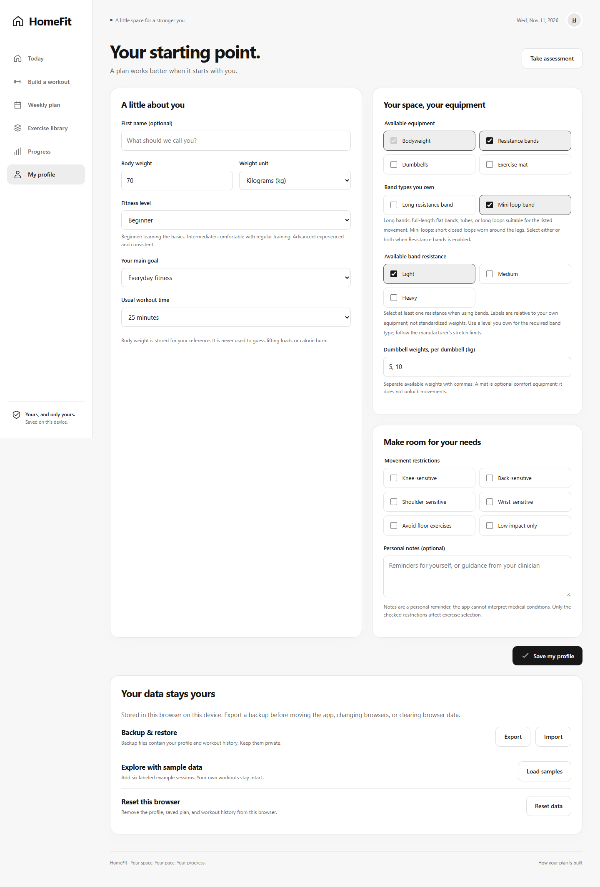

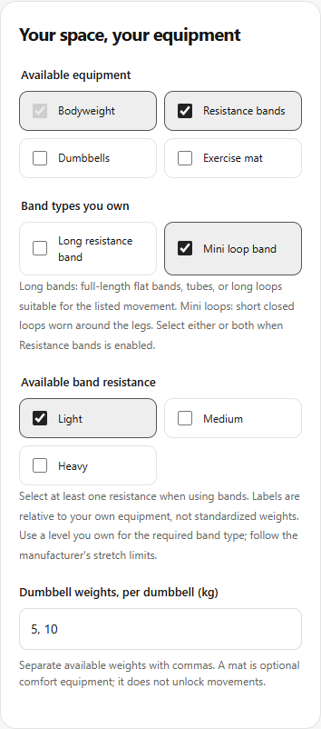

Light/medium/heavy are relative labels within your own equipment. They are not standardized kilogram values or band colors. The app never automatically advances you to a heavier band. It keeps recent comparable resistance when still available and appropriate; otherwise it starts conservatively. Dumbbell suggestions likewise use available weights, not body weight.

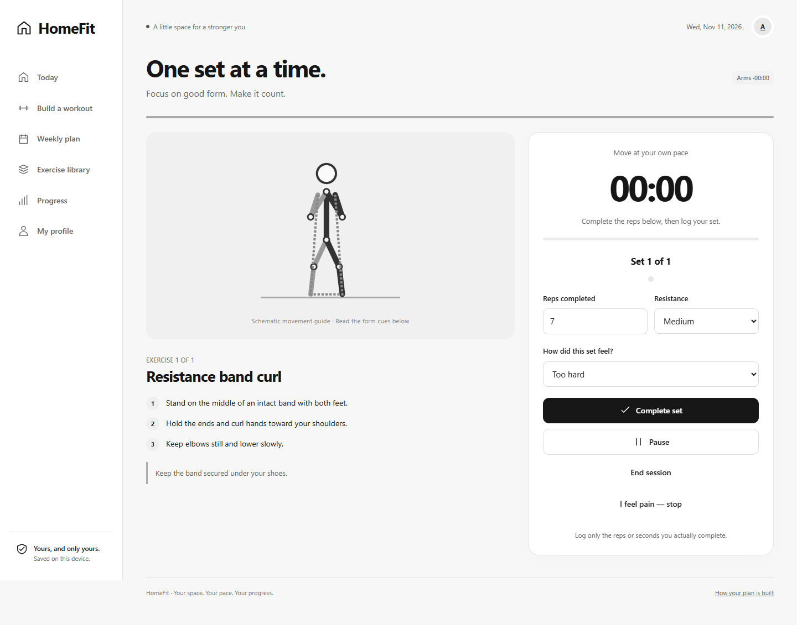

## Pain feedback

- **Pain during a working set:** Use **I feel pain — stop** or select pain in the set check-in. The active movement is flagged, including if you stop before logging its first set.
- **Pain during warm-up, rest, or cooldown:** The app records general discomfort, without guessing which exercise caused it.
- **Pain reported during review:** Mark affected movements individually, or choose general discomfort. The form will not save an ambiguous pain report.
- **Known affected movement:** That movement is excluded. Unrelated logged movements are not automatically blamed.
- **General or old unidentified pain:** New plans pause until you review the report in Progress.
- **After resolving the cause:** Open that session in Progress and choose **Clear pain feedback**, then review the confirmation. The original feedback stays in history with a resolution date. This is not medical clearance.

Stop if a movement causes pain, dizziness, or unusual shortness of breath. Seek qualified guidance for injuries, medical conditions, or uncertainty about returning to training. HomeFit is a general-fitness tool, not rehabilitation or diagnosis.

## Plan a sustainable week

1. Open **Weekly plan**.
2. Choose two or three training days and the first training weekday.
3. Select **Save weekly rhythm**.
4. Preview any training day with **View session**.
5. On its actual date, choose **Use this session**, review the plan, and start.

**Success indicator:** The seven-day view includes recovery days between training days, including across the week boundary. Completed scheduled sessions link to history; partial sessions are not marked fully complete.

Beginners and two-day schedules use full-body sessions. More experienced three-day schedules rotate upper body, lower body, and full body. Profile restrictions, assessment, resistance availability, and feedback still apply to every generated session. Recent overlapping training can change a planned day into extra recovery. Missed sessions are not stacked into recovery days. The schedule uses your device's local dates and opens the current week automatically.

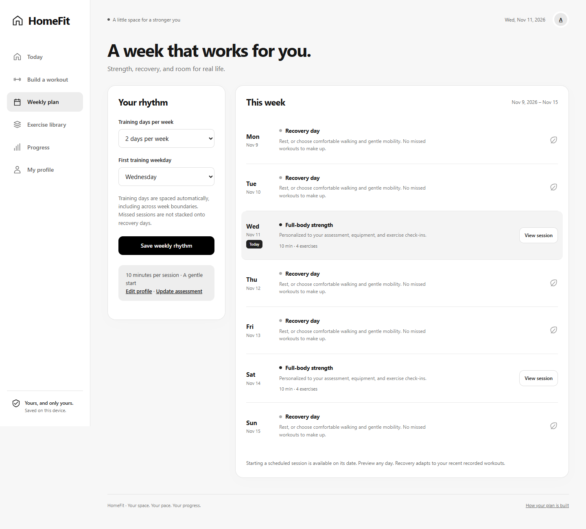

## Data preservation and privacy

- Storage remains under **homefit.v1** with a compatible `version: 1` envelope and an added `revision: 2` field.
- The first load of legacy data adds optional defaults in memory and preserves the original stored JSON under **homefit.v1.pre-v2** before the next normal save.
- Profile fields, history, stable exercise IDs, active-session IDs, completed sets, and elapsed time are retained. Old plan estimates are recalculated to remove the extra final rest. An active session is restored paused.
- The original project's files were archived separately as `HomeFit-v1-backup.zip`. That archive is a source backup; it does not contain your browser's personal workout data.
- Backup/import accepts valid version-one and updated files. A malformed import is rejected before it can replace stored data.
- Sample sessions are labeled and excluded from adaptive and weekly planning decisions. Removing samples preserves real sessions.
- The app has no API calls, analytics, remote fonts, accounts, or user-data uploads. Source-reference links intentionally open external websites only when clicked.
- Data is local, not encrypted by HomeFit. Exported backups include personal notes, weight, restrictions, assessment, and history; keep them private.
- Clearing browser data, switching browsers, private browsing, or moving the local folder can make storage unavailable. Export a backup first.
- Corrupt saved data is not silently overwritten. A visible storage warning means you should export before closing.
- Use one active HomeFit tab. If another tab changes the stored data, this tab stops saving and asks you to reload.
- **Reset data** requires confirmation and clears the current state and the retained pre-upgrade browser snapshot.

## Evidence and boundaries

[CDC adult activity guidance](https://www.cdc.gov/physical-activity-basics/guidelines/adults.html) includes strengthening on at least two days a week alongside aerobic activity. [CDC examples](https://www.cdc.gov/physical-activity-basics/adding-adults/what-counts.html) include resistance bands and bodyweight work. The [2026 ACSM guidance](https://acsm.org/resistance-training-guidelines-update-2026/) emphasizes consistency, individualized programming, and the usefulness of home-based and band training.

The [NHS strength exercise guide](https://www.nhs.uk/live-well/exercise/strength-exercises/) and [Health and Wellbeing Queensland push-up guidance](https://hw.qld.gov.au/physical-activity/push-ups-on-bench-wall-floor/) describe accessible bodyweight pushing movements. HomeFit applies conservative product rules inspired by these general principles; its specific exercise variants and manual-resistance dosing are product choices. Its assessment thresholds, exercise filters, calendar recovery spacing, rep estimates, and feedback decisions are not clinically validated prescriptions. It does not calculate maximum lifts, diagnose injuries, claim calorie-burn accuracy, or automatically increase resistance. Diagrams are schematic form aids rather than an assessment of your own technique.

## More screenshots

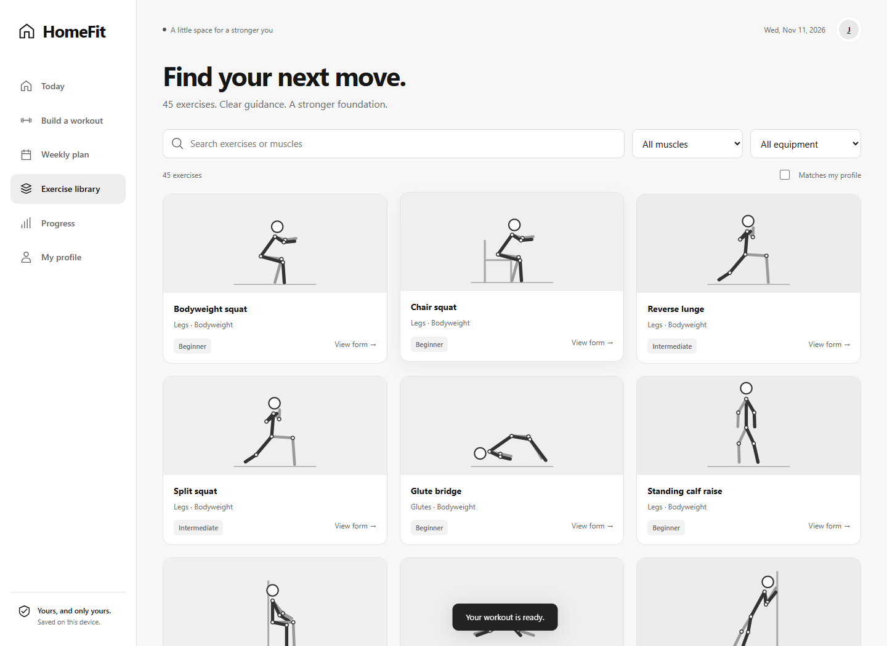

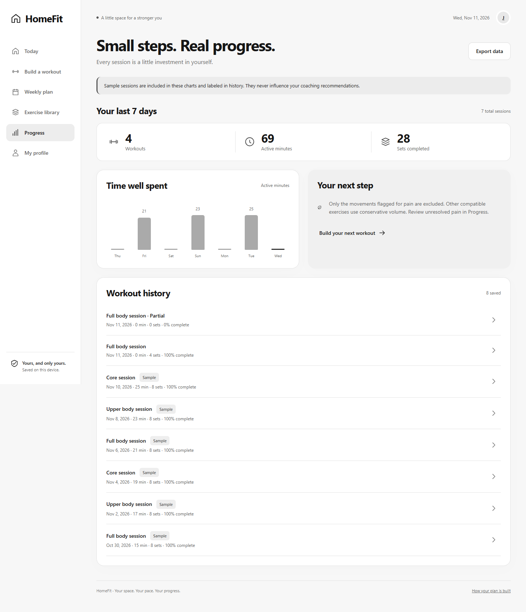

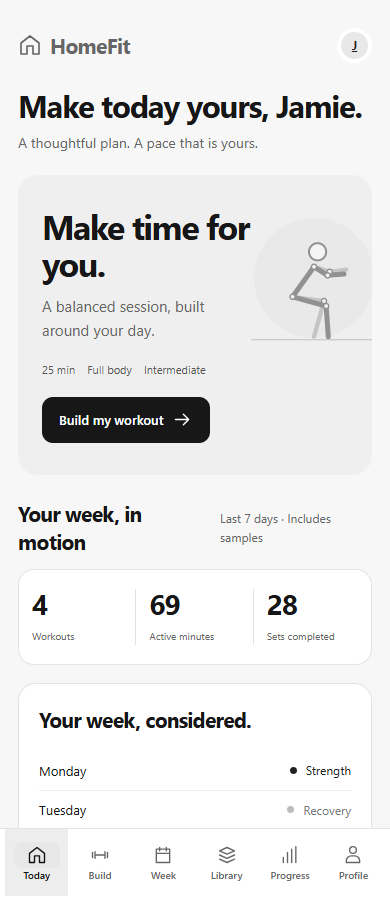 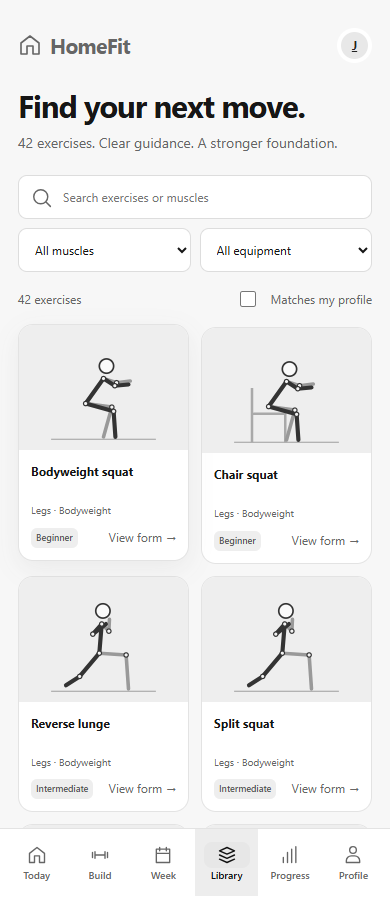

Screenshots contain fictional test data. Your existing browser data is not used for testing.

## Development and testing

Users do not need these commands. The application remains plain HTML, CSS, and JavaScript with no build step or runtime dependencies.

With Node.js 20 or newer:

```sh
npm test
```

**Success indicator:** 37 functional tests pass, including the original 3,150-combination planning matrix and 360 additional band-inventory planning cases with replacement and weekly-plan checks, duration accounting, safe substitutions, assessment behavior, exercise-level progression, resistance levels, pain resolution, weekly recovery, and v1 migration.

Optional browser QA:

```sh
npm install
npx playwright install chromium
npm run test:browser
```

To use an already installed Chrome browser in PowerShell:

```powershell
$env:HOMEFIT_BROWSER_CHANNEL = 'chrome'
npm run test:browser
```

**Success indicator:** 37 browser checks pass: 17 original regression flows, 11 enhancement flows, and 9 equipment/arm regression flows. All three scripts create temporary localhost-only servers, use isolated browser contexts and fictional data, write screenshots/results, and close the browser and server afterward. Set `HOMEFIT_SCREENSHOTS` to choose the output directory. The focused equipment suite defaults to a sibling `homefit-equipment-qa` folder.

The checks cover profile persistence, complete/partial sessions, pause and reload recovery, timers and active-time limits, actual set inputs, resistance selection, exercise feedback, assessment, weekly scheduling, known/general pain, migration, samples, export/import, malformed backups, unavailable storage, offline interactions, runtime errors, and desktop/mobile layouts. Computed colors are checked for grayscale.

Browser verification used Google Chrome via Playwright over localhost. Direct-file navigation remains unautomated because the in-app preview tool blocks `file://`; the local-file architecture uses classic deferred scripts and relative assets, with no fetch or module loader. Safari, Firefox, physical mobile devices, and screen-reader interaction have not been verified.

## Files

- `index.html`: same double-click entry point.
- `styles.css` and `enhancements.css`: existing layout and grayscale/new-screen refinements.
- `exercises.js`: 45 stable exercise IDs, including three bodyweight arm movements and explicit long-band/mini-loop requirements.
- `engine.js`: recommendation, assessment, replacement, weekly scheduling, validation, and migration logic.
- `app.js`: existing app screens, local storage, session state machine, and new flows.
- `tests/`: engine and browser regression suites.
- `docs/`: actual screenshots, [verification results](docs/QA.md), and [design provenance](docs/DESIGN.md).

All application assets can also be served by a static web host. Hosting is optional; no deployment was performed.
